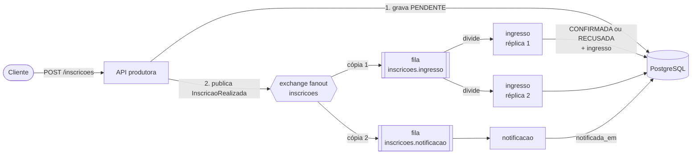

# Inscrições em eventos com RabbitMQ

Trabalho semestral de Arquitetura de Software (UFR, prof. Maikon Bueno, 2026/2).
Dupla: Hugo Adriano de Oliveira e NOME DO COLEGA.

Organização escolhida: **C · Event-Driven com broker**.

A pessoa se inscreve num evento pela API. A API grava a inscrição como `PENDENTE`, publica o evento `InscricaoRealizada` no RabbitMQ e responde na hora com `202`. Dois consumidores recebem esse mesmo evento, cada um na sua fila:

- **ingresso** (2 réplicas na mesma fila): vê se ainda tem vaga e emite o ingresso. A inscrição vira `CONFIRMADA` ou `RECUSADA`.
- **notificacao**: manda o e-mail de "recebemos sua inscrição" (no projeto, o e-mail é uma linha no log).

## Arquitetura



Duas ideias explicam o sistema inteiro:

1. A **exchange fanout copia** a mensagem para todas as filas ligadas a ela. Por isso o mesmo evento chega ao ingresso e à notificação.
2. Dentro de **uma fila, os consumidores dividem** as mensagens. Cada mensagem vai para uma réplica só. Por isso as duas réplicas do ingresso repartem o trabalho sem emitir ingresso duplicado.

Containers (todos no `compose.yaml`): `postgres`, `rabbitmq`, `api`, `ingresso` (x2) e `notificacao`.

## Requisito e onde está no código

| Requisito do enunciado | Como foi feito | Onde |
|---|---|---|
| Uma API produtora, 2 ou 3 rotas | Express com 3 rotas: `GET /eventos`, `POST /inscricoes`, `GET /inscricoes/:id`. Só a API publica mensagens. | [`src/api.ts`](src/api.ts) |
| Uma fila dividida entre workers | Fila `inscricoes.ingresso` consumida por 2 réplicas do mesmo serviço, com `prefetch(1)` | [`compose.yaml`](compose.yaml) (`deploy.replicas: 2`), [`src/broker.ts`](src/broker.ts) (`consumir`) |
| Um evento com dois assinantes | Evento `InscricaoRealizada` publicado na exchange `inscricoes` do tipo fanout, com duas filas ligadas | [`src/broker.ts`](src/broker.ts) (`EXCHANGE`, `FILAS`, `conectar`) |
| 2 consumidores, cada um com uma única tarefa | `ingresso`: emitir o ingresso se tiver vaga. `notificacao`: mandar o e-mail. | [`src/consumidores/ingresso.ts`](src/consumidores/ingresso.ts), [`src/consumidores/notificacao.ts`](src/consumidores/notificacao.ts) |
| 2 ou 3 entidades | `eventos`, `inscricoes` e `ingressos` | [`db/init.sql`](db/init.sql) |
| Repositório git | Este repositório público | |
| Roda com Docker | `docker compose up --build`, o mesmo Dockerfile serve para a API e para os consumidores | [`Dockerfile`](Dockerfile), [`compose.yaml`](compose.yaml) |
| PostgreSQL em container próprio | Serviço `postgres` separado, com volume e healthcheck. A porta não é exposta para fora. | [`compose.yaml`](compose.yaml) |

Detalhes que deixam o fluxo confiável:

| O quê | Por quê | Onde |
|---|---|---|
| Ack manual | A mensagem só sai da fila depois que a tarefa terminou. Se o consumidor morrer no meio, o RabbitMQ entrega para outro. | `consumir` em `src/broker.ts` |
| Idempotência | Mensagem repetida não gera segundo ingresso (status já não é `PENDENTE`) nem segundo e-mail (`notificada_em` já preenchido) | `ingresso.ts`, `notificacao.ts` |
| `SELECT ... FOR UPDATE` no evento | Com 2 réplicas ao mesmo tempo, só uma conta as vagas por vez. O evento nunca passa do limite. | `ingresso.ts` |
| Filas e mensagens duráveis + confirm channel | Nada se perde se o RabbitMQ reiniciar, e a API só responde depois que o broker confirmou a mensagem | `src/broker.ts` |
| Fila de falhas `inscricoes.falhas` | Mensagem que dá erro sai da fila principal (sem laço infinito) e fica guardada para análise | `src/broker.ts` |

## Como rodar

Precisa só de Docker com o Compose.

```bash
git clone https://github.com/OwlHugo/arquitetura-trabalho-semestral.git
cd arquitetura-trabalho-semestral
docker compose up --build -d --wait
```

O `--wait` só devolve o terminal quando o Postgres, o RabbitMQ e a API passaram no healthcheck.

- API: http://localhost:3000
- Painel do RabbitMQ: http://localhost:15672 (usuário `inscricoes`, senha `inscricoes`). Em *Exchanges* aparece a `inscricoes` (fanout) e em *Queues* as filas com o número de consumidores.

Se a porta 3000 ou 15672 já estiver em uso na sua máquina: `API_PORTA=3001 PAINEL_PORTA=15673 docker compose up --build -d --wait` (os scripts de demo leem as mesmas variáveis).

Para desligar e apagar os dados: `docker compose down -v`.

## Demonstração

```bash
./demo.sh          # 10 inscrições num evento de 8 vagas (aceita outro número: ./demo.sh 20)
./demo-queda.sh    # derruba a notificação, inscreve, mostra a mensagem esperando na fila e sobe de novo
```

O `demo.sh` mostra a topologia no RabbitMQ, as respostas `202` da API, os logs das duas réplicas dividindo a fila, a notificação recebendo o mesmo evento, o resultado no banco (8 confirmadas, 2 recusadas) e um reenvio do mesmo evento sendo ignorado pelos dois consumidores.

Para ver os logs ao vivo: `docker compose logs -f ingresso notificacao`.

## Testando na mão com curl

```bash
# eventos e vagas restantes
curl http://localhost:3000/eventos

# nova inscrição (responde 202 com status PENDENTE)
curl -i -X POST http://localhost:3000/inscricoes \
  -H 'Content-Type: application/json' \
  -d '{"eventoId": 1, "nome": "Ana", "email": "ana@exemplo.com"}'

# consulta: status, ingresso e notificadaEm já preenchidos pelos consumidores
curl http://localhost:3000/inscricoes/1
```

Respostas de erro: `400` (faltou campo), `404` (evento ou inscrição não existe), `409` (e-mail já inscrito no mesmo evento).

## Estrutura

```
src/
  api.ts                     API produtora (3 rotas)
  broker.ts                  tudo do RabbitMQ: exchange, filas, publicar e consumir
  db.ts                      conexão com o PostgreSQL
  consumidores/
    ingresso.ts              consumidor 1: emite o ingresso (2 réplicas)
    notificacao.ts           consumidor 2: manda o e-mail
db/init.sql                  tabelas e eventos de exemplo
compose.yaml                 os 6 containers
demo.sh, demo-queda.sh       roteiros da demonstração
docs/adr-001-event-driven.md por que a arquitetura ficou assim
```

## Como adicionar um terceiro assinante

Exemplo: um consumidor `certificado` que gera o certificado de participação. A API não muda em nada, porque ela só publica o evento e não sabe quem escuta.

1. `src/broker.ts`: acrescentar `certificado: "inscricoes.certificado"` em `FILAS`. O `conectar()` já cria a fila e liga na exchange.
2. `src/consumidores/certificado.ts`: copiar o `notificacao.ts` e trocar a tarefa.
3. `compose.yaml`: um serviço `certificado` com `<<: *app` e `command: node dist/consumidores/certificado.js`.
4. Se ele gravar algo, a tabela nova vai em `db/init.sql`.

Para dar mais força a um consumidor que já existe, basta subir mais réplicas: `docker compose up -d --scale ingresso=3`.
